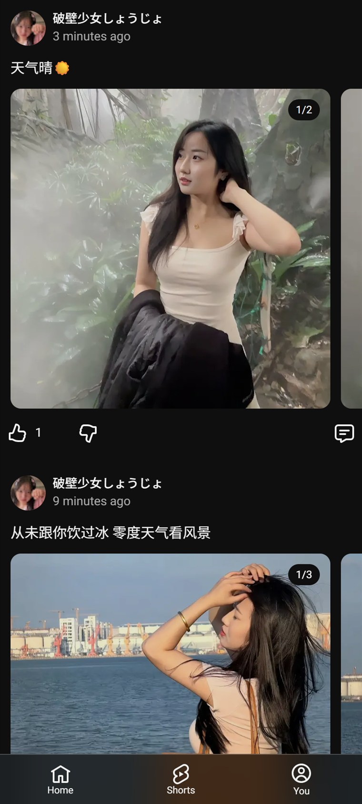
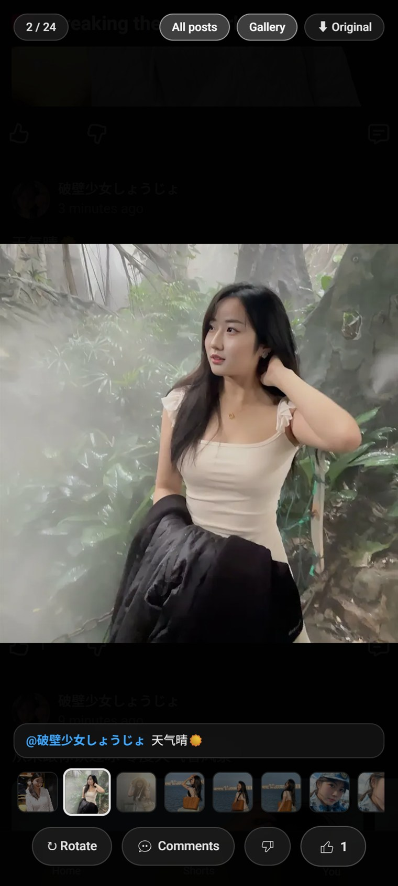

# YouTube Mobile Community Image Viewer

Opening an image in an `m.youtube.com` community post gives you one lonely picture: no zoom, no gallery, and saving the original can be hijacked by YouTube's SPA router to a `blob:` URL from which you cannot go back. This userscript turns it into a full-screen mobile gallery with the controls a phone photo viewer should have.

**English** | [简体中文](README.zh-CN.md)

- Install: [Greasy Fork](https://greasyfork.org/en/scripts/605153)
- Source: [GitHub](https://github.com/devycx/yt-community-image-viewer) · [direct .user.js](https://raw.githubusercontent.com/devycx/yt-community-image-viewer/main/yt-community-image-viewer.user.js)
- Works on: `*://m.youtube.com/*`
- Version: 4.6.1
- UI language: English / 简体中文 (follows the device or browser locale)
- Design notes: [Why it takes 1,000+ lines, and the three-layer download fix](https://ycxdev.com/posts/m-youtube-community-image-gallery/)

## Screenshots

  
  

Left: a community post in the `m.youtube.com` feed; the images are a bare `1/2` carousel. Right: the same post after one tap — full-screen gallery with the `2 / 24` cross-post counter, **All posts** / **Gallery** / **⬇ Original** in the top bar, the author and caption above the thumbnail strip, and the thumb-zone action bar: **Rotate**, **Comments**, dislike, and a large **Like** button.

Screenshots are captured in a 412×915 mobile viewport at 2× DPR. The Chinese UI is shown in [README.zh-CN.md](README.zh-CN.md).

## Gestures

| Gesture | Action |
| --- | --- |
| Single tap | Toggle immersive view: hide or restore every control, leaving only the image. |
| Double tap | Zoom to 2.5x around the tap point; double-tap again to reset to fit. |
| Pinch | 0.75x–5x zoom around the pinch center; below 1x springs back on release; panning is clamped to the image edges. |
| One-finger drag while zoomed | Pan the image; edges resist instead of running away. |
| One-finger horizontal swipe | Change image (9% of the viewport, or a flick faster than 0.22 px/ms); the first and last image resist. |
| One-finger vertical swipe | The image follows and shrinks (down to 0.55x) while the backdrop fades; release past 55px closes. |
| Long press 450ms | Haptic feedback and save the full-resolution original. |
| Tap a thumbnail | Jump to that image; the strip centers it. |
| System back / edge swipe | Closes the gallery first, not the community page (history guard). |
| Rotate | Rotate the current image in 90° steps. |

## Core features

- **Thumb-zone action bar**: like (with count), dislike, comments and rotate sit at the bottom where a thumb reaches. A vote updates the pill immediately, then clicks YouTube's native button and re-reads the real DOM state over the next few hundred milliseconds.
- **Author and caption preview**: the active post's `@author` and text appear above the thumbnail strip. Tap the bar to expand long captions; tap again to collapse.
- **Cross-post infinite browsing**: by default, images from every community post on the page go into one gallery. Near the last image the script scrolls the underlying page to `ytm-continuation-item-renderer` to trigger YouTube's own infinite loader; new post images are appended incrementally by a `MutationObserver` without rebuilding existing nodes.
- **Bottom thumbnail strip**: the current image is highlighted and auto-centered; the top-bar **Gallery** toggle hides the strip.
- **Full-screen motion**: opening clones the already-decoded feed `` into the slide, measures the tapped thumbnail and animates a FLIP transform from that rectangle to the full-screen frame. Closing reverses it, scrolling the underlying page back to the post first if the thumbnail has left the viewport.
- **Original image download**: `ggpht` / `googleusercontent` URLs are rewritten to `=s0` for maximum resolution; long-press or tap **⬇ Original**.
- **Persistent preferences**: the **All posts** and **Gallery** toggles are stored in `localStorage` under `yt_mobile_img_viewer_cfg_v4`.

## Download hijack fix (v4.3)

YouTube's global click router takes over `<a>` tags with a `download` attribute or a `blob:` URL, sends the current page to the blob URL, and back navigation cannot return to the post. The fix has three layers:

1. **Top-level capture at document-start**: the script registers a `click` capture listener before YouTube's router; when it sees a download link it calls `stopPropagation` + `stopImmediatePropagation` but **not** `preventDefault`, preserving the native download.
2. **Trigger inside a hidden iframe**: the download `<a>` lives in a dedicated iframe document, so the main document's router listeners never see the node.
3. **Wrap in octet-stream**: the fetched image blob is repackaged as `application/octet-stream`, so mobile browsers download it instead of previewing it in the current tab.

If cross-origin `fetch` fails, it falls back to `window.open` in a new tab and never hijacks the current page.

## Implementation notes

- **FLIP geometry**: on open, compute `dx / dy / scale` from the tapped thumbnail and the full-screen render size; place the large image at the thumbnail first, then animate it to the center. On close, if the thumbnail has scrolled out of view, scroll the underlying page back to the post first, then shrink.
- **Gesture state machine**: `pinch` / `pan` / `horizontal-gallery` / `vertical-dismiss`; the mode is chosen from the first movement direction and current zoom, so horizontal paging and vertical dismissal do not fight. A single finger stays in `none` until it moves 8px, so a double tap is not eaten by the pan handler.
- **Composited layers**: the track and images stay on `translate3d`, `will-change`, and `backface-visibility: hidden`, so animation does not trigger layout.
- **Event isolation**: touch events on the top bar, caption, thumbnail strip and action bar call `stopPropagation`, so they do not reach the gesture layer or the page below.
- **Trusted Types safe**: icons are built with `createElementNS` instead of `innerHTML`, so the script also works when a userscript manager injects it into the page context on YouTube's Trusted Types-protected pages.
- **Image identity**: `ggpht` / `googleusercontent` URLs are normalized by stripping size and crop suffixes (`=s640-c-...`); the same image is not appended twice when YouTube swaps resolution URLs during lazy loading.
- **DOM dependencies**: matches `ytm-backstage-post-renderer`, `ytm-post-multi-image-renderer`, `ytm-backstage-image-renderer`, `ytm-comment-action-buttons-renderer`, and the legacy `.post-image-container`; avatar and comment images are excluded with `closest()`.

## Known limits

- Only matches `m.youtube.com`; desktop `www.youtube.com` is not affected.
- Depends on YouTube's current mobile DOM and custom element names; a redesign may require selector updates.
- Cross-post browsing scrolls the underlying page to trigger loading; this is intentional. Turn off **All posts** to browse only the current post.
- In very long sessions the gallery only grows (it is cleared on close); browsing hundreds of images uses more memory.
- When signed out, tapping like or dislike follows YouTube's own sign-in flow.
- YouTube's current mobile action bar does not expose a comment count, so the **Comments** pill shows the label and jumps to the post's comment thread instead of a number.
- `@grant none`: downloads use page-level `fetch`. If YouTube changes the image domain's CORS policy, it falls back to a new tab.

## FAQ

**Does it work on desktop YouTube?**
No. It only matches `*://m.youtube.com/*`; `www.youtube.com` is untouched. A desktop user agent on `m.youtube.com` may also be redirected to the desktop site.

**How do I close the viewer?**
Swipe the image down more than 55px, or use the phone's back gesture / back button. A single tap now toggles immersive view instead of closing, so the gallery does not disappear when you tap to hide the controls.

**How do I save the original image, not the feed thumbnail?**
Long-press for 450ms, or tap **⬇ Original** in the top bar. `ggpht` / `googleusercontent` URLs are rewritten to `=s0` first, then fetched as a blob and handed to the browser as `application/octet-stream` so it downloads instead of opening.

**Why did a download open a new tab?**
The cross-origin `fetch` failed (CORS or network), so the script fell back to `window.open` with the original URL. The current page is never hijacked.

**Which script managers are supported?**
Tampermonkey, Violentmonkey, and the Safari / iOS userscript managers (`Userscripts`, `Orion`). `@grant none` is enough — no GM APIs required.

**Does it collect anything?**
No. There is no analytics and no remote code; the only network request is fetching the image you chose to download.

**Does it work inside the YouTube app?**
No. Userscripts only run in a browser, so open `m.youtube.com` in Chrome/Safari/Firefox on the phone.

**How do I change the UI language?**
The script follows `navigator.languages`: `zh-*` gets Chinese, everything else gets English. The YouTube page language itself is controlled by YouTube, not by this script.

## License

MIT, see [LICENSE](LICENSE).
