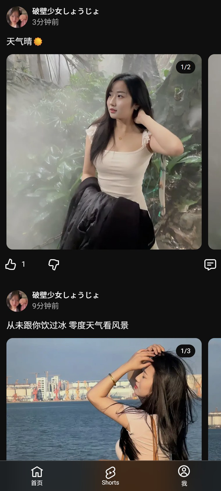
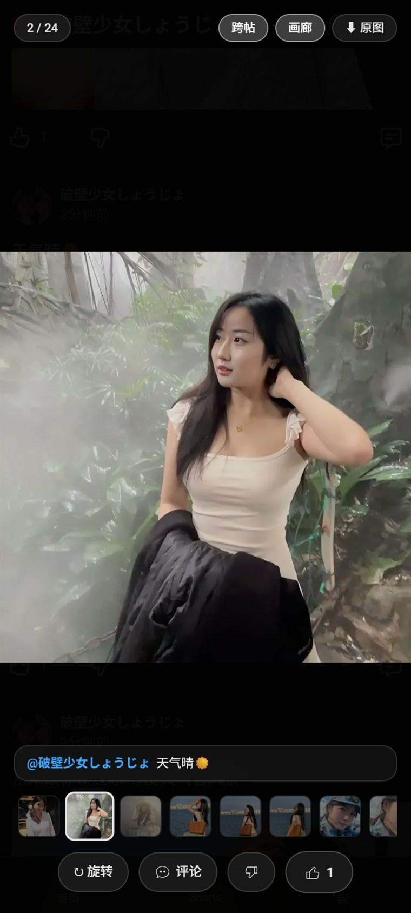

# YouTube 移动版社区图片全屏查看器

`m.youtube.com` 的社区帖图片点开就是一张孤零零的图：不能缩放、没有画廊、想存原图还会被 YouTube 的 SPA 路由劫持到 `blob:` 地址回不来。这个脚本把它补成一个完整的移动端相册，操作按手机看图的手感来。

[English](README.md) | **简体中文**

- 安装：[Greasy Fork](https://greasyfork.org/zh-CN/scripts/605153)
- 源码：[GitHub](https://github.com/devycx/yt-community-image-viewer) · [直接安装 .user.js](https://raw.githubusercontent.com/devycx/yt-community-image-viewer/main/yt-community-image-viewer.user.js)
- 适用范围：`*://m.youtube.com/*`
- 版本：4.6.1
- 界面语言：English / 简体中文（跟随设备或浏览器语言）
- 长文说明：[为什么写到一千多行、下载防跳转的三层修法](https://ycxdev.com/posts/m-youtube-community-image-gallery/)

## 截图

  
  

左：`m.youtube.com` 信息流里的社区帖，图片只是原生 `1/2` 轮播。右：点开之后的画廊——`2 / 24` 是跨帖连播的计数，顶栏是「跨帖」「画廊」「⬇ 原图」，缩略图轨上方是作者和帖子文案，底部是拇指区操作栏：「↻ 旋转」「💬 评论」、点踩和大号「👍 赞」。

截图来自 412×915 移动端视口、2× DPR；英文界面见 [README.md](README.md)。

## 手势

| 手势 | 行为 |
| --- | --- |
| 单击 | 切换沉浸看图：收起或恢复全部控件，只留主图 |
| 双击 | 以双击点为中心放大到 2.5x；再双击还原到适应屏幕 |
| 双指捏合 | 0.75x–5x 缩放，焦点跟手；松手后小于 1x 回弹到 1x；平移会被限制在图片边缘内 |
| 放大后单指拖动 | 平移图片，到边缘有阻尼，不会把图拖丢 |
| 单指横滑 | 切换图片（超过视口 9% 或甩动速度超过 0.22 px/ms）；第一张/最后一张有阻尼 |
| 单指纵滑 | 图片跟手缩小（最小 0.55x）、背景变淡，下拉超过 55px 松手关闭 |
| 长按 450ms | 震动反馈并保存最大分辨率原图 |
| 点缩略图 | 直接跳到对应图片，缩略图轨自动居中 |
| 系统返回 / 侧滑返回 | 先关闭画廊，不会直接退出社区页面（历史栈保护） |
| 旋转 | 当前图片按 90° 步进旋转 |

## 核心功能

- **拇指区操作栏**：点赞（带点赞数）、点踩、评论跳转和旋转都放在底部拇指自然落点。点赞/点踩先乐观更新胶囊，再点 YouTube 原生按钮，随后分阶段回读 DOM 的真实状态。
- **作者与文案预览**：当前帖子的 `@作者` 和正文显示在缩略图轨上方；点一下文案条展开全文，再点收起。
- **跨帖无限连播**：默认把页面上所有社区帖的图片收进同一个画廊。滑到倒数第二张时开始驱动底层页面滚到 `ytm-continuation-item-renderer`，触发 YouTube 自己的无限加载；新帖图片由 `MutationObserver` 增量追加，不重建已有节点。
- **底部缩略图轨**：当前图片高亮并自动滚到中间；顶栏「画廊」开关可隐藏。
- **零闪变开合**：打开时克隆信息流里已经解码好的 ``，按被点缩略图与全屏尺寸算 FLIP 矩阵，从缩略图位置展开到屏幕中央；关闭反向缩回。原图已滚出视口时，先把底层页面滚回帖子位置。
- **原图下载**：`ggpht` / `googleusercontent` 的地址重写成 `=s0` 拿最大分辨率，长按或点顶栏「⬇ 原图」都能存。
- **偏好持久化**：「跨帖」「画廊」两个开关存在 `localStorage` 的 `yt_mobile_img_viewer_cfg_v4` 里，刷新后恢复。

## 下载防跳转（v4.3）

YouTube 的全局点击路由会接管带 `download` 属性或 `blob:` 地址的 `<a>`，把当前页跳到 blob 地址，之后后退也回不到帖子。修复分三层：

1. **document-start 顶层捕获**：脚本在 YouTube 路由之前注册 `click` 捕获监听，命中下载链接就 `stopPropagation` + `stopImmediatePropagation`，但**不调用** `preventDefault`，保留浏览器原生下载。
2. **隐藏 iframe 里触发**：下载用的 `<a>` 建在专用 `iframe` 的文档里，主文档的路由监听器根本接触不到这个节点。
3. **octet-stream 包一层**：拿到的图片 blob 重新包成 `application/octet-stream`，避免移动端浏览器把 blob 当图片在当前标签页预览而不是下载。

跨域 `fetch` 失败时退回 `window.open` 新标签页打开原图，不会劫持当前页。

## 实现要点

- **FLIP 几何**：打开时按被点缩略图与全屏渲染尺寸算出 `dx / dy / scale`，先把大图放到缩略图位置再动画到中心；关闭时如果原图已滚出视口，先把底层页面滚回帖子位置，再缩回去。
- **手势状态机**：`pinch` / `pan` / `horizontal-gallery` / `vertical-dismiss` 四种模式，按首次移动的方向和当前缩放决定，避免横滑翻页和纵滑关闭打架。单指按下先保持 `none`，移动超过 8px 才判定方向，双击不会被平移逻辑吃掉。
- **合成层**：轨道和图片常驻 `translate3d`、`will-change`、`backface-visibility: hidden`，动画期间不触发布局。
- **事件隔离**：顶栏、文案条、缩略图轨和操作栏上的触摸事件全部 `stopPropagation`，不会穿透到手势层或底层页面。
- **Trusted Types 兼容**：图标用 `createElementNS` 构建而不是 `innerHTML`，即使用户脚本管理器把代码注入页面上下文，也不会被 YouTube 的 Trusted Types 策略拦掉。
- **图片去重**：`ggpht` / `googleusercontent` 地址会剥掉尺寸和裁剪后缀（如 `=s640-c-...`）再当主键，懒加载换分辨率时不会把同一张图重复加进画廊。
- **DOM 依赖**：认 `ytm-backstage-post-renderer`、`ytm-post-multi-image-renderer`、`ytm-backstage-image-renderer`、`ytm-comment-action-buttons-renderer`，兼容旧的 `.post-image-container`；头像、评论区图片通过 `closest()` 排除。

## 已知边界

- 只匹配 `m.youtube.com`，桌面版 `www.youtube.com` 不生效。
- 依赖 YouTube 当前的移动端 DOM 结构和自定义元素名，改版可能需要更新选择器。
- 跨帖连播会滚动底层页面来触发加载，这是有意的；关掉「跨帖」后就只浏览当前帖子。
- 超长会话里画廊节点只增不减（关闭时清空），一次浏览几百张图会占用更多内存。
- 未登录时点赞/点踩会走 YouTube 自己的登录流程。
- YouTube 当前移动端操作栏不提供评论数，所以「评论」胶囊显示文字并跳到帖子评论区，不显示数字。
- `@grant none`，下载走页面级 `fetch`。YouTube 调整图片域 CORS 策略时会走新标签页兜底。

## 常见问题

**桌面版 YouTube 能用吗？**
不能。只匹配 `*://m.youtube.com/*`，`www.youtube.com` 完全不碰；桌面 UA 访问 `m.youtube.com` 还可能被重定向到桌面版。

**怎么关闭画廊？**
图片往下滑超过 55px，或用手机的系统返回/侧滑返回。单击现在是切换沉浸模式，不再关闭画廊，所以点一下藏起控件时不会误退出。

**怎么存原图？**
长按 450ms，或点顶栏「⬇ 原图」。脚本会把 `ggpht` / `googleusercontent` 的尺寸后缀重写成 `=s0` 拿最大分辨率，再包成 `application/octet-stream` 交给浏览器下载。

**为什么下载会新开一个标签页？**
跨域 `fetch` 失败（CORS 或网络问题）时走了 `window.open` 兜底，当前页不会被劫持。

**支持哪些油猴管理器？**
Tampermonkey、Violentmonkey，以及 Safari / iOS 上的 `Userscripts`、`Orion`。脚本是 `@grant none`，不需要 GM API。

**会收集数据吗？**
不会。没有统计、不加载远程代码，唯一的网络请求是下载时取你选中的那张图。

**YouTube App 里能用吗？**
不能。油猴脚本只在浏览器里跑，要用手机浏览器打开 `m.youtube.com`。

**界面语言怎么切？**
脚本跟随 `navigator.languages`：`zh-*` 显示中文，其余显示英文。YouTube 页面本身的语言由 YouTube 控制，和脚本无关。

## License

MIT，见 [LICENSE](LICENSE)。
