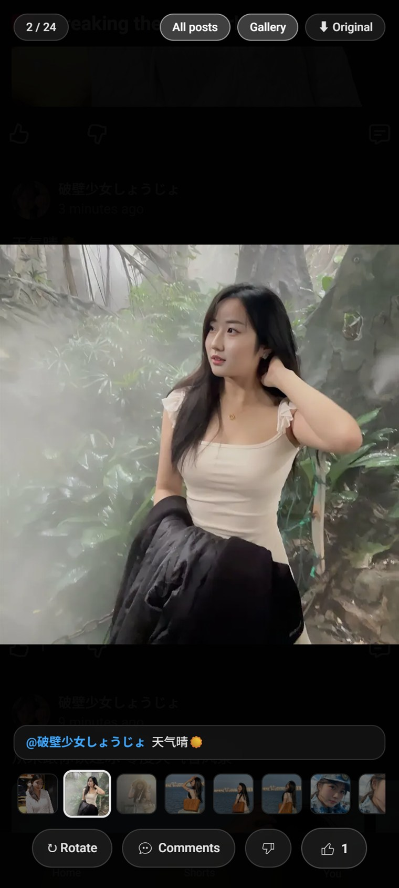

## What it does

Community images on `m.youtube.com` open in a bare viewer: one image, no zoom, no gallery, and saving the original can bounce the page to a `blob:` URL you cannot go back from. This script replaces it with a full-screen mobile gallery.

- Swipe between images; pinch for 0.75x–5x zoom; double-tap for 2.5x around the tap point, double-tap again to reset.
- Bottom thumbnail strip; tap a thumbnail to jump.
- Thumb-zone bar: like (with count), dislike, comments and 90° rotate, all synced with the post's native buttons.
- Author + caption preview; tap the caption to expand or collapse it.
- Single tap toggles immersive view (controls hidden, image only); the phone's back gesture / edge swipe closes the gallery first.
- Cross-post browsing: near the last image it triggers YouTube's own "load more" and appends new images.
- Long-press (450 ms) or tap **⬇ Original** to download the full-resolution image. The download fix uses capture-phase click handling, a hidden iframe and `application/octet-stream`, so YouTube's router cannot hijack it.
- "All posts" and "Gallery" preferences persist in `localStorage`.
- English by default; the UI switches to 简体中文 on `zh-*` devices.

## Screenshots

  
  

Left: a community post in the `m.youtube.com` feed. Right: the same post after one tap — full-screen gallery, `2 / 24` cross-post counter, **All posts** / **Gallery** / **⬇ Original**, the author/caption bar, the thumbnail strip, and the thumb-zone bar (**Rotate**, **Comments**, dislike, **Like**).

## How to use

Install Tampermonkey or Violentmonkey, open a channel's **Posts** tab or any community post on `m.youtube.com`, and tap an image. Swipe to browse, pinch or double-tap to zoom, tap once for immersive view, swipe down or use the system back gesture to close. Long-press to save the original.

Works on Chrome, Firefox, Edge, and Safari on Android and iOS (Safari needs the Userscripts or Orion extension). The YouTube app itself is not supported: userscripts only run in a browser.

## Privacy and permissions

`@grant none`. No tracking, no analytics, no remote code. The only network request is fetching the image you chose to download. Toggles are stored locally in `localStorage`.

## Limitations

- Mobile only (`m.youtube.com`); desktop `www.youtube.com` is not affected.
- Depends on YouTube's mobile DOM; a redesign may require selector updates.
- Cross-post browsing scrolls the underlying feed to trigger loading; turn **All posts** off to stay in one post.
- YouTube's current mobile action bar does not expose a comment count, so **Comments** shows the label and jumps to the comment thread.
- When signed out, like/dislike follows YouTube's own sign-in flow.
- If a cross-origin image fetch fails, it opens the image in a new tab instead.

Source and issue tracker: [GitHub](https://github.com/devycx/yt-community-image-viewer). MIT. Design notes (Chinese): [why it takes 1,000+ lines and how the download fix works](https://ycxdev.com/posts/m-youtube-community-image-gallery/).
