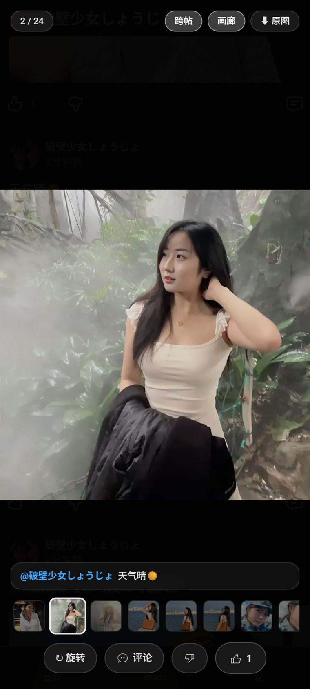

## 它做什么

`m.youtube.com` 的社区帖图片点开只有一张：不能缩放、没有画廊，存原图还可能把页面跳到 `blob:` 地址回不来。脚本把它补成完整的全屏画廊。

- 左右滑切换图片；双指 0.75x–5x 缩放；双击以落点为中心放大 2.5x，再双击还原。
- 底部缩略图轨，点缩略图直接跳转。
- 拇指区操作栏：点赞（带点赞数）、点踩、评论跳转和 90° 旋转，全部和原帖原生按钮同步。
- 作者 + 文案预览；点文案条展开/收起全文。
- 单击切换沉浸看图（只留主图）；手机返回/侧滑返回先关闭画廊，不会退出社区页。
- 跨帖连播：滑到末尾附近会触发 YouTube 自己的「加载更多」，把新图追加进画廊。
- 长按 450ms 或点「⬇ 原图」下载最大分辨率。下载修复用捕获阶段点击拦截 + 隐藏 iframe + `application/octet-stream`，YouTube 路由接管不了。
- 「跨帖」「画廊」偏好存在 `localStorage`。
- 默认英文；`zh-*` 设备自动切到简体中文。

## 截图

  
  

左：信息流里的社区帖，图片只是原生 `1/2` 轮播。右：点一下之后的画廊——`2 / 24` 是跨帖计数，顶部是「跨帖」「画廊」「⬇ 原图」，缩略图轨上方是作者和文案，底部是「↻ 旋转」「💬 评论」、点踩和大号「👍 赞」。

## 使用

装 Tampermonkey 或 Violentmonkey，打开 `m.youtube.com` 频道页的「帖子」或任意社区帖，点任意图片即可。左右滑翻图，捏合或双击缩放，单击进沉浸模式，下拉或系统返回关闭，长按保存原图。

Chrome、Firefox、Edge、安卓和 iOS 的 Safari 都能用（Safari 需要 Userscripts 或 Orion 扩展）。YouTube App 内不支持：油猴脚本只在浏览器里运行。

## 隐私与权限

`@grant none`。无跟踪、无统计、不加载远程代码，唯一的网络请求是下载时取你选中的那张原图。开关偏好存在本地 `localStorage`。

## 已知边界

- 仅移动版 `m.youtube.com`；桌面版 `www.youtube.com` 不生效。
- 依赖 YouTube 移动端 DOM，改版后可能需要更新选择器。
- 跨帖连播会滚动底层信息流来触发加载；关掉「跨帖」就只浏览当前帖子。
- YouTube 当前移动端操作栏不提供评论数，「评论」显示文字并跳到评论区。
- 未登录时点赞/点踩会走 YouTube 自己的登录流程。
- 跨域取图失败时会退回新标签页打开原图。

源码与问题反馈：[GitHub](https://github.com/devycx/yt-community-image-viewer)。MIT。设计说明：[为什么写到一千多行、下载防跳转的三层修法](https://ycxdev.com/posts/m-youtube-community-image-gallery/)。
